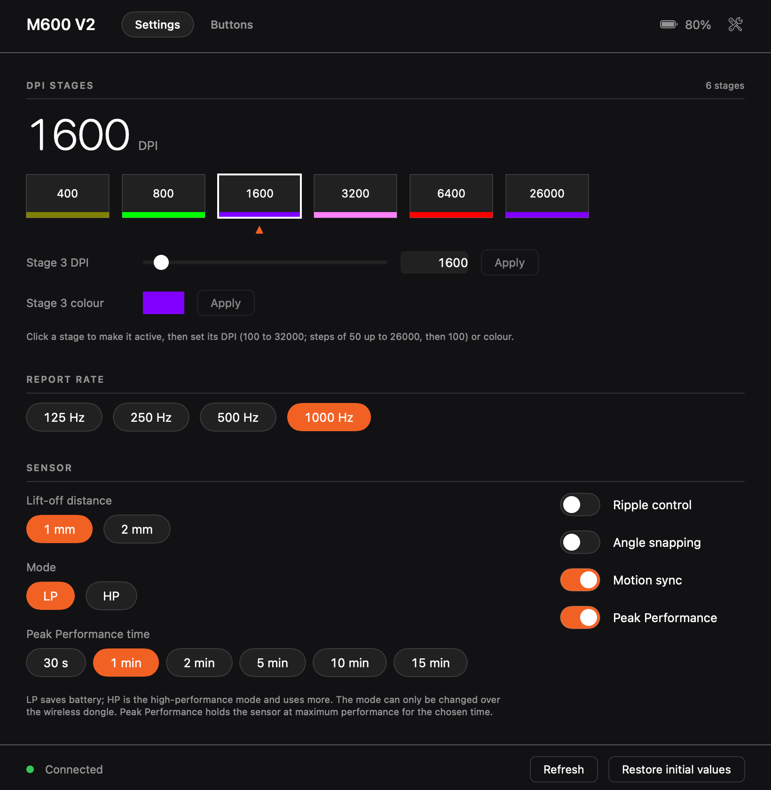
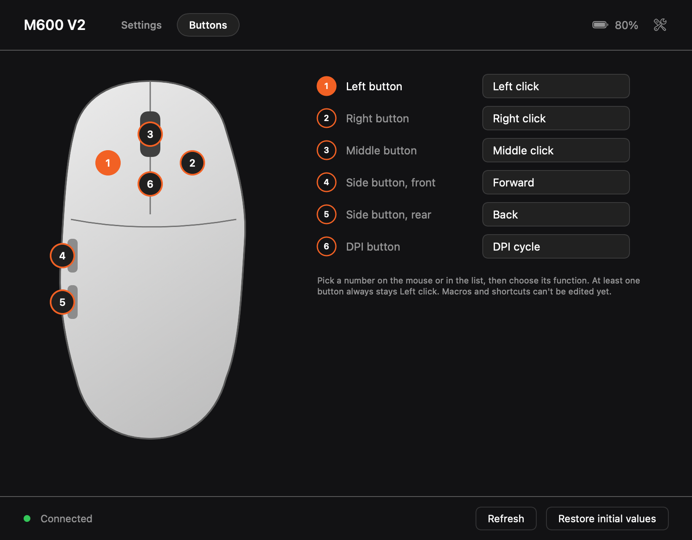

# OpenMouse for Kysona M600 V2

An unofficial macOS app for configuring the Kysona M600 V2 mouse, written from scratch in Swift.
The vendor's configuration tool only runs on Windows.




*The pictures are rendered with demo values (`OpenMouse --render-preview out.png [buttons]`), no mouse attached. The mouse drawing is our own, not vendor artwork.*

## Status

Tested on one mouse: **Kysona M600 V2 through its 2.4G dongle** (USB `3554:F5D5`). Other dongles
and the wired mouse use the same vendor ID and are matched, but are untested.

| Feature | Read | Write |
|---|---|---|
| DPI stages (value, colour, active stage) | yes | yes: pick the active stage, then set its DPI (100 to 32000) and colour |
| Report rate 125 / 250 / 500 / 1000 Hz | yes | yes |
| Lift-off distance 1 / 2 mm | yes | yes |
| Ripple control, angle snapping, motion sync | yes | yes |
| Sensor mode (LP / HP), Peak Performance on/off and duration | yes | yes (wireless only for the mode) |
| Battery | yes (meaning of the bytes is inferred) | – |
| Button remaps (clicks, DPI, scroll, report rate, profile, disable) | yes | yes (six physical buttons) |
| Macros, shortcuts, fire key, LED settings | not decoded yet | no |
| Firmware update | never | never |

Every write is checked: the mouse must echo the frame back, and the value is read back and
compared. The app also refreshes by itself when you press the mouse's own DPI or report-rate button.

## Build and run

Needs macOS 13+ and a Swift 5.9 toolchain (Xcode or the command line tools).

```sh
swift run OpenMouse        # run from the package
swift test                 # protocol and parser tests
Scripts/make-app.sh        # builds dist/OpenMouse.app (ad-hoc signed)
```

macOS asks for **Input Monitoring** the first time, because the mouse's control channel is a HID
interface shared with the pointer. Allow it in System Settings → Privacy & Security → Input
Monitoring, then restart the app. The app never seizes the device, so the pointer keeps working.

The wrench button opens a Diagnostics sheet with the HID interface list, raw probes and the traffic log.

## How it was made

The code, protocol layer and UI are written from scratch for interoperability. The protocol itself was
worked out from static analysis of the vendor's Windows library (frame layout and checksum), then
corrected and extended with USB captures of the vendor app talking to the mouse, screen recordings
with a clock to match each action to its packets, and tests against real hardware. No vendor code,
strings, artwork or firmware are copied or included.

- [PROTOCOL_NOTES.md](PROTOCOL_NOTES.md) is the protocol spec: framing, checksum, commands, flash map.
- [DESIGN.md](DESIGN.md) covers the layout, open questions and safety rules.

In short: 17-byte HID output reports with report ID 8, `0x55 − sum` checksum, flash reads and writes
addressed in bytes 3–4, and settings stored as `value, checksum` pairs.

## Safety

Writes are limited to six one-byte settings and an allow-list of values. The commands that
update firmware, switch boot modes or change the device's USB identity are deliberately not
implemented. Use at your own risk; see the licence.

## Contributing

See [CONTRIBUTING.md](CONTRIBUTING.md) and [docs/capturing.md](docs/capturing.md). Captures are the most useful contribution: a USBPcap/Wireshark capture of the vendor app changing
one setting at a time, with the clock visible in a screen recording. Macros, shortcuts, LED settings
and sensor mode are the missing pieces.

This project is not affiliated with or endorsed by Kysona. "Kysona" and "M600" are used only to
say which hardware it works with.

## Licence

MIT, see [LICENSE](LICENSE).
